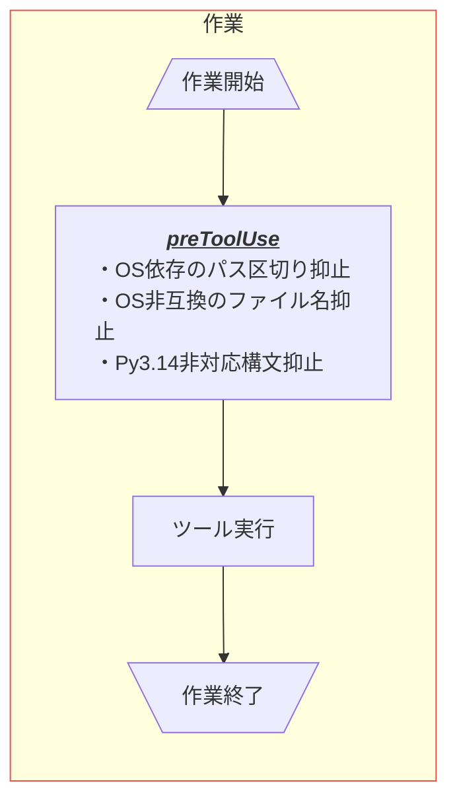

# .github -repo- README

このリポジトリ専用のhookについて記載する。共通のhookと前提条件は [.github/README.md](./README.md) を参照。

## hookについて

### 配置

- hook定義は `.github/hooks/-repo-<event-name>.json`、hookのファイルは [.github/hooks/helpers/-repo-events/](./hooks/helpers/-repo-events/) 配下に置く。
- 起動は共通のhookと同じく [hookランナー](./hooks/helpers/runner/README.md) を通す。テストは [test-all-hooks.py](./hooks/tests/test-all-hooks.py) の一括実行に含まれる。
- 作成・更新の規約は [hookの共通規約](./skills/create-hook/references/hook-conventions.md) を参照。

### 発動フロー

<table>
  <thead>
    <tr><th>イベント</th><th>条件</th><th>内容</th><th>hook</th></tr>
  </thead>
  <tbody>
    <tr>
      <td>preToolUse</td>
      <td></td>
      <td>OS依存のパス区切り抑止</td>
      <td><a href="./hooks/helpers/-repo-events/preToolUse/block-native-path-separators/README.md">block-native-path-separators</a></td>
    </tr>
    <tr>
      <td>preToolUse</td>
      <td></td>
      <td>OS非互換のファイル名抑止</td>
      <td><a href="./hooks/helpers/-repo-events/preToolUse/block-nonportable-paths/README.md">block-nonportable-paths</a></td>
    </tr>
    <tr>
      <td>preToolUse</td>
      <td></td>
      <td>Py3.14非対応構文抑止</td>
      <td><a href="./hooks/helpers/-repo-events/preToolUse/block-py314-incompatible-syntax/README.md">block-py314-incompatible-syntax</a></td>
    </tr>
  </tbody>
</table>

## CIについて

- [-repo-hook-tests.yml](./workflows/-repo-hook-tests.yml) はmainへのpushとmain向けPRで（Markdownのみの変更を除く）、Linux・Windows・macOS上のPython 3.14でhookのテスト一式を実行する。
