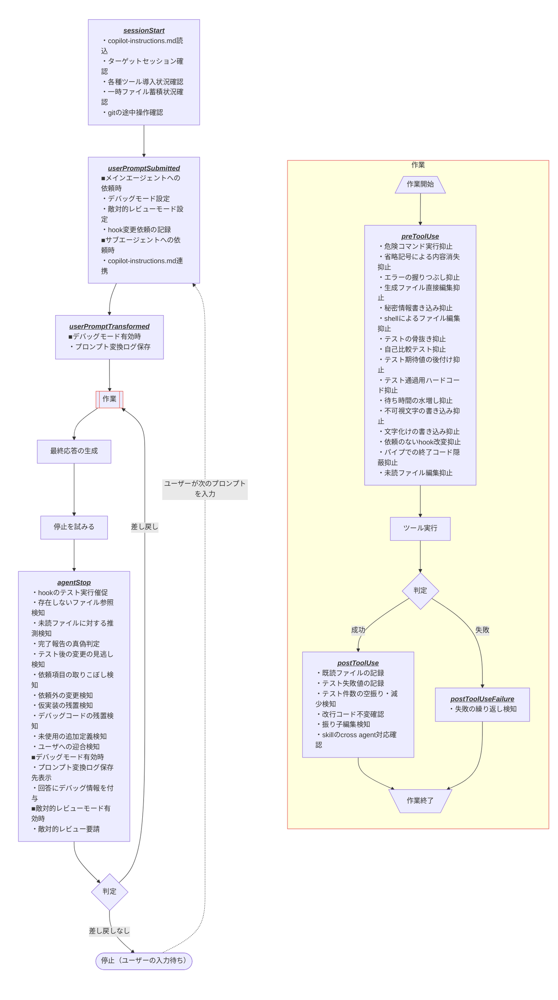

# .github README

## Codex・Claudeでの利用

- Codexは [AGENTS.md](../AGENTS.md) と [.agents/skills](../.agents/skills)、Claudeは [CLAUDE.md](../CLAUDE.md) と [.claude/skills](../.claude/skills) を通じて、共通指示とskillを利用できる。hookは共有対象外。
- 指示と手順の正本は [.github/copilot-instructions.md](./copilot-instructions.md) と [.github/skills](./skills) 。ラッパーの作成・同期ルールは [skillの共通規約](./skills/create-skill/references/skill-conventions.md) を参照。

## hookについて

### 前提条件

- このリポジトリのhookはCopilot SDK形式のみを対象とする。
- VS CodeのCopilot Chatで使う場合は、Session Targetを `Copilot` にする。
- `Copilot` targetはCLIと同じSDK hook実装を使うが、利用中のVS Codeが対象イベントに対応するか確認する。
- `Local`、`Claude`、`Codex`などSDK以外の実行環境は対象外とし、互換処理やfallbackを実装せず、動作も検証しない。
- `.py` の実行にはPython 3.14以降が必要で、起動コマンドはmacOS/Linuxでは `python3`、Windowsでは `python` を使う。

### 発動フロー

<table>
  <thead>
    <tr><th>イベント</th><th>条件</th><th>内容</th><th>hook</th></tr>
  </thead>
  <tbody>
    <tr>
      <td rowspan="9">sessionStart</td>
      <td rowspan="9"></td>
      <td>copilot-instructions.md読込</td>
      <td><a href="./hooks/helpers/events/sessionStart/load-copilot-instructions/README.md">load-copilot-instructions</a></td>
    </tr>
    <tr>
      <td>ターゲットセッション確認</td>
      <td><a href="./hooks/helpers/events/sessionStart/check-target-session/README.md">check-target-session</a></td>
    </tr>
    <tr>
      <td rowspan="5">各種ツール導入状況確認</td>
      <td><a href="./hooks/helpers/events/sessionStart/check-python/README.md">check-python</a></td>
    </tr>
    <tr><td><a href="./hooks/helpers/events/sessionStart/check-ast-grep/README.md">check-ast-grep</a></td></tr>
    <tr><td><a href="./hooks/helpers/events/sessionStart/check-git/README.md">check-git</a></td></tr>
    <tr><td><a href="./hooks/helpers/events/sessionStart/check-jq/README.md">check-jq</a></td></tr>
    <tr><td><a href="./hooks/helpers/events/sessionStart/check-ripgrep/README.md">check-ripgrep</a></td></tr>
    <tr>
      <td>一時ファイル蓄積状況確認</td>
      <td><a href="./hooks/helpers/events/sessionStart/check-hook-temp-files/README.md">check-hook-temp-files</a></td>
    </tr>
    <tr>
      <td>gitの途中操作確認</td>
      <td><a href="./hooks/helpers/events/sessionStart/check-git-state/README.md">check-git-state</a></td>
    </tr>
    <tr>
      <td rowspan="4">userPromptSubmitted</td>
      <td rowspan="3">メインエージェントへの依頼時</td>
      <td>デバッグモード設定</td>
      <td><a href="./hooks/helpers/events/userPromptSubmitted/set-debug-mode/README.md">set-debug-mode</a></td>
    </tr>
    <tr>
      <td>敵対的レビューモード設定</td>
      <td><a href="./hooks/helpers/events/userPromptSubmitted/set-adversarial-review-state/README.md">set-adversarial-review-state</a></td>
    </tr>
    <tr>
      <td>hook変更依頼の記録</td>
      <td><a href="./hooks/helpers/events/userPromptSubmitted/record-hook-change-requests/README.md">record-hook-change-requests</a></td>
    </tr>
    <tr>
      <td>サブエージェントへの依頼時</td>
      <td>copilot-instructions.md連携</td>
      <td><a href="./hooks/helpers/events/userPromptSubmitted/give-subagents-instructions/README.md">give-subagents-instructions</a></td>
    </tr>
    <tr>
      <td>userPromptTransformed</td>
      <td>デバッグモード有効時</td>
      <td>プロンプト変換ログ保存</td>
      <td><a href="./hooks/helpers/events/userPromptTransformed/debug-log-transformed-prompt/README.md">debug-log-transformed-prompt</a></td>
    </tr>
    <tr>
      <td rowspan="16">preToolUse</td>
      <td rowspan="16"></td>
      <td>危険コマンド実行抑止</td>
      <td><a href="./hooks/helpers/events/preToolUse/block-commands/README.md">block-commands</a></td>
    </tr>
    <tr>
      <td>省略記号による内容消失抑止</td>
      <td><a href="./hooks/helpers/events/preToolUse/block-elided-rewrites/README.md">block-elided-rewrites</a></td>
    </tr>
    <tr>
      <td>エラーの握りつぶし抑止</td>
      <td><a href="./hooks/helpers/events/preToolUse/block-error-swallowing/README.md">block-error-swallowing</a></td>
    </tr>
    <tr>
      <td>生成ファイル直接編集抑止</td>
      <td><a href="./hooks/helpers/events/preToolUse/block-generated-file-edits/README.md">block-generated-file-edits</a></td>
    </tr>
    <tr>
      <td>秘密情報書き込み抑止</td>
      <td><a href="./hooks/helpers/events/preToolUse/block-secret-writes/README.md">block-secret-writes</a></td>
    </tr>
    <tr>
      <td>shellによるファイル編集抑止</td>
      <td><a href="./hooks/helpers/events/preToolUse/block-shell-file-edits/README.md">block-shell-file-edits</a></td>
    </tr>
    <tr>
      <td>テストの骨抜き抑止</td>
      <td><a href="./hooks/helpers/events/preToolUse/block-test-weakening/README.md">block-test-weakening</a></td>
    </tr>
    <tr>
      <td>自己比較テスト抑止</td>
      <td><a href="./hooks/helpers/events/preToolUse/block-tautological-tests/README.md">block-tautological-tests</a></td>
    </tr>
    <tr>
      <td>テスト期待値の後付け抑止</td>
      <td><a href="./hooks/helpers/events/preToolUse/block-goalpost-moving/README.md">block-goalpost-moving</a></td>
    </tr>
    <tr>
      <td>テスト通過用ハードコード抑止</td>
      <td><a href="./hooks/helpers/events/preToolUse/block-hardcoding-for-tests/README.md">block-hardcoding-for-tests</a></td>
    </tr>
    <tr>
      <td>待ち時間の水増し抑止</td>
      <td><a href="./hooks/helpers/events/preToolUse/block-timeout-inflation/README.md">block-timeout-inflation</a></td>
    </tr>
    <tr>
      <td>不可視文字の書き込み抑止</td>
      <td><a href="./hooks/helpers/events/preToolUse/block-invisible-characters/README.md">block-invisible-characters</a></td>
    </tr>
    <tr>
      <td>文字化けの書き込み抑止</td>
      <td><a href="./hooks/helpers/events/preToolUse/block-mojibake-writes/README.md">block-mojibake-writes</a></td>
    </tr>
    <tr>
      <td>依頼のないhook改変抑止</td>
      <td><a href="./hooks/helpers/events/preToolUse/block-hook-tampering/README.md">block-hook-tampering</a></td>
    </tr>
    <tr>
      <td>パイプでの終了コード隠蔽抑止</td>
      <td><a href="./hooks/helpers/events/preToolUse/block-masked-exit-codes/README.md">block-masked-exit-codes</a></td>
    </tr>
    <tr>
      <td>未読ファイル編集抑止</td>
      <td><a href="./hooks/helpers/events/preToolUse/require-read-before-edit/README.md">require-read-before-edit</a></td>
    </tr>
    <tr>
      <td rowspan="6">postToolUse</td>
      <td rowspan="6"></td>
      <td>既読ファイルの記録</td>
      <td><a href="./hooks/helpers/events/postToolUse/record-seen-files/README.md">record-seen-files</a></td>
    </tr>
    <tr>
      <td>テスト失敗値の記録</td>
      <td><a href="./hooks/helpers/events/postToolUse/record-test-failure-values/README.md">record-test-failure-values</a></td>
    </tr>
    <tr>
      <td>テスト件数の空振り・減少検知</td>
      <td><a href="./hooks/helpers/events/postToolUse/detect-vacuous-test-success/README.md">detect-vacuous-test-success</a></td>
    </tr>
    <tr>
      <td>改行コード不変確認</td>
      <td><a href="./hooks/helpers/events/postToolUse/preserve-line-endings/README.md">preserve-line-endings</a></td>
    </tr>
    <tr>
      <td>振り子編集検知</td>
      <td><a href="./hooks/helpers/events/postToolUse/detect-edit-oscillation/README.md">detect-edit-oscillation</a></td>
    </tr>
    <tr>
      <td>skillのcross agent対応確認</td>
      <td><a href="./hooks/helpers/events/postToolUse/check-cross-agent-skill-wrappers/README.md">check-cross-agent-skill-wrappers</a></td>
    </tr>
    <tr>
      <td>postToolUseFailure</td>
      <td></td>
      <td>失敗の繰り返し検知</td>
      <td><a href="./hooks/helpers/events/postToolUseFailure/detect-repeated-failures/README.md">detect-repeated-failures</a></td>
    </tr>
    <tr>
      <td rowspan="14">agentStop</td>
      <td rowspan="11"></td>
      <td>hookのテスト実行催促</td>
      <td><a href="./hooks/helpers/events/agentStop/require-hook-tests/README.md">require-hook-tests</a></td>
    </tr>
    <tr>
      <td>存在しないファイル参照検知</td>
      <td><a href="./hooks/helpers/events/agentStop/detect-phantom-references/README.md">detect-phantom-references</a></td>
    </tr>
    <tr>
      <td>未読ファイルに対する推測検知</td>
      <td><a href="./hooks/helpers/events/agentStop/detect-unread-speculation/README.md">detect-unread-speculation</a></td>
    </tr>
    <tr>
      <td>完了報告の真偽判定</td>
      <td><a href="./hooks/helpers/events/agentStop/verify-completion-claims/README.md">verify-completion-claims</a></td>
    </tr>
    <tr>
      <td>テスト後の変更の見逃し検知</td>
      <td><a href="./hooks/helpers/events/agentStop/detect-stale-verification/README.md">detect-stale-verification</a></td>
    </tr>
    <tr>
      <td>依頼項目の取りこぼし検知</td>
      <td><a href="./hooks/helpers/events/agentStop/detect-dropped-requirements/README.md">detect-dropped-requirements</a></td>
    </tr>
    <tr>
      <td>依頼外の変更検知</td>
      <td><a href="./hooks/helpers/events/agentStop/detect-unrequested-changes/README.md">detect-unrequested-changes</a></td>
    </tr>
    <tr>
      <td>仮実装の残置検知</td>
      <td><a href="./hooks/helpers/events/agentStop/detect-stub-placeholders/README.md">detect-stub-placeholders</a></td>
    </tr>
    <tr>
      <td>デバッグコードの残置検知</td>
      <td><a href="./hooks/helpers/events/agentStop/detect-debug-leftovers/README.md">detect-debug-leftovers</a></td>
    </tr>
    <tr>
      <td>未使用の追加定義検知</td>
      <td><a href="./hooks/helpers/events/agentStop/detect-orphaned-additions/README.md">detect-orphaned-additions</a></td>
    </tr>
    <tr>
      <td>ユーザへの迎合検知</td>
      <td><a href="./hooks/helpers/events/agentStop/detect-sycophantic-reversal/README.md">detect-sycophantic-reversal</a></td>
    </tr>
    <tr>
      <td rowspan="2">デバッグモード有効時</td>
      <td>プロンプト変換ログ保存先表示</td>
      <td><a href="./hooks/helpers/events/agentStop/debug-show-prompt-log-paths/README.md">debug-show-prompt-log-paths</a></td>
    </tr>
    <tr>
      <td>回答にデバッグ情報を付与</td>
      <td><a href="./hooks/helpers/events/agentStop/debug-add-response-footer/README.md">debug-add-response-footer</a></td>
    </tr>
    <tr>
      <td>敵対的レビューモード有効時</td>
      <td>敵対的レビュー要請</td>
      <td><a href="./hooks/helpers/events/agentStop/request-adversarial-review/README.md">request-adversarial-review</a></td>
    </tr>
  </tbody>
</table>

### デバッグモード

先頭 `??` のプロンプトを入力するとデバッグモードになり、 `debug-` 接頭辞付きのhookが発動するようになる。詳細は[set-debug-mode hook README](./hooks/helpers/events/userPromptSubmitted/set-debug-mode/README.md)を参照。

### 敵対的レビューモード

末尾 `;;` のプロンプトを入力すると、変更差分のレビューを[敵対的レビューエージェント](./agents/adversarial-review.agent.md)に依頼する。詳細は[request-adversarial-review hook README](./hooks/helpers/events/agentStop/request-adversarial-review/README.md)を参照。

### 一時ファイル

- hookは状態ファイルとデバッグログを、一時フォルダー配下に出力する。
- 上記が一定の条件を満たすと、セッション開始時に[削除用skill](./skills/clean-hook-temp-files/SKILL.md)の実行を推奨する。
- 詳細は[check-hook-temp-files hook README](./hooks/helpers/events/sessionStart/check-hook-temp-files/README.md)を参照。

### テスト

#### Pylanceの設定

- hookのテストは、実行時に `sys.path` へ [.github/hooks/tests/helpers](./hooks/tests/helpers) を追加して共通処理を読み込む。
- Pylanceがこの読み込みを解決できるよう、リポジトリ直下の [pyrightconfig.json](../pyrightconfig.json) で同じパスを `extraPaths` に指定している。
- hookはWindows・macOS・Linuxのすべてを対象にし、`os.name == 'nt'` などでOSごとに分岐するため、`pythonPlatform` を `All` にして、実行中のOS以外向けの分岐も解析させる。
- このファイルがあると、Pylanceは `python.analysis.*` の設定（`typeCheckingMode` など）よりこのファイルを優先するため、ユーザー設定で変えている項目はこのファイルにも記載する。

### トラブルシューティング

#### デバッグフッターにsessionStartのhookが載らない

デバッグモードで回答に付与される（[debug-add-response-footer](./hooks/helpers/events/agentStop/debug-add-response-footer/README.md)）フッターに `check-python` や `load-copilot-instructions` などsessionStartのhookが載らないのは仕様。
- 「Hooks used」は、直近のユーザー発言以降にトランスクリプトへ記録された `hook.start` のイベント種別から、起動した可能性のあるhookを推定する。ユーザー発言のたびに収集済みのイベント種別をリセットするため、最初のユーザー発言より前に動くsessionStartのhookは表示範囲外になる。
- 「Hooks fired」は、直近のユーザー依頼の `userPromptSubmitted` の `hook.start` 以降に[hookランナー](./hooks/helpers/runner/README.md)経由で起動し、終了コードが0以外か、空・空白だけ・空のJSONオブジェクト（`{}`）以外の標準出力を返したhookが対象。sessionStartはターンの区切りより前のため対象外で、さらに `block-commands` や `check-python` はランナーを通さないため起動も機能も記録されない。

#### デバッグフッターの「Hooks used」にhookが並ぶのに「Hooks fired」がnoneになる

デバッグモードで回答に付与される（[debug-add-response-footer](./hooks/helpers/events/agentStop/debug-add-response-footer/README.md)）フッターに設けられている「Hooks used」はイベント種別からの推定であり、各hookが実際に出力したことを示すものではない。「Hooks fired」は上記の条件で機能したhookだけを表示し、agentStopのhookは同時実行の結果をフッター作成時点で確定できないため除外する。ランナーを通さない `block-commands` や `check-python` も対象外になる。

そのため、ツールを呼び出さないターンでは「Hooks used」にagentStopのhookが並んでも、「Hooks fired」が `none` になることがある。フッターに載らないことや `none` だけでは、hookが起動しなかったとは判断できない。