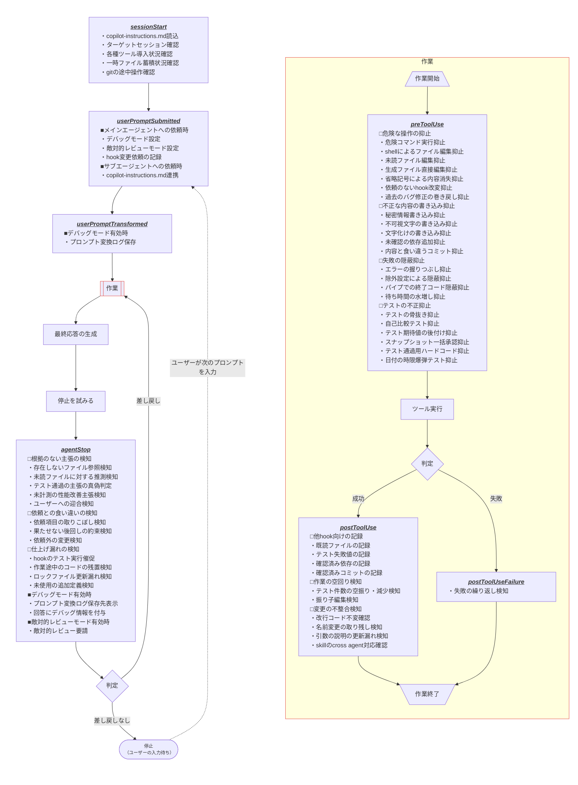
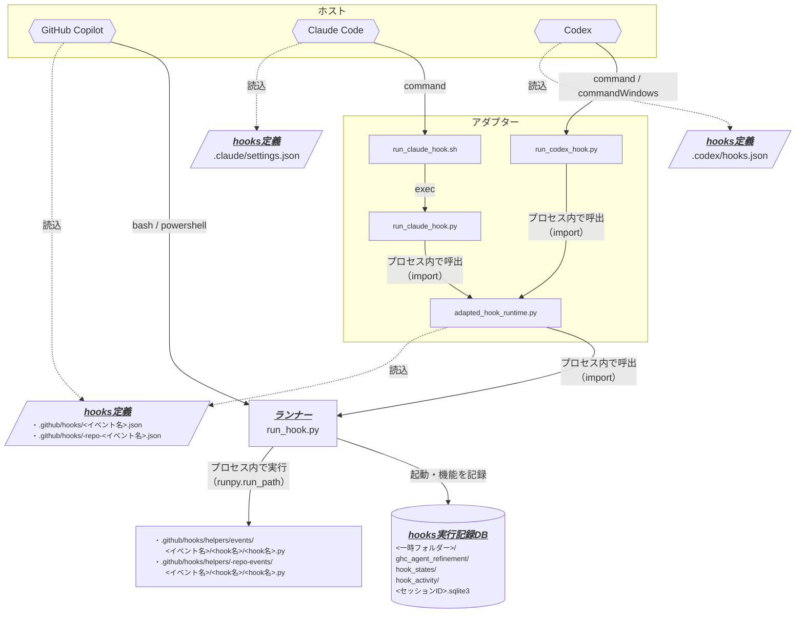

# .github README

## Codex・Claudeでの利用
- Codexは [AGENTS.md](../AGENTS.md) と [.agents/skills](../.agents/skills)、Claudeは [CLAUDE.md](../CLAUDE.md) と [.claude/skills](../.claude/skills) を通じて、共通指示とskillを利用できる。
- hookは、Codexでは [.codex/hooks.json](../.codex/hooks.json)、Claude Codeでは [.claude/settings.json](../.claude/settings.json) に登録したアダプターを通じて利用できる。構成と制約は [.codex/README.md](../.codex/README.md) と [.claude/README.md](../.claude/README.md) を参照。
- 指示と手順の正本は [.github/copilot-instructions.md](./copilot-instructions.md) と [.github/skills](./skills)。ラッパーの作成・同期ルールは [skillの共通規約](./skills/create-skill/references/skill-conventions.md) を参照。

## hookについて
### 前提条件
- このリポジトリのhookはCopilot SDK形式で実装する。CodexとClaude Codeでは、入出力をSDK形式に変換するアダプターを通じて同じhookを実行する（[Codex](../.codex/README.md)、[Claude Code](../.claude/README.md)）。
- VS CodeのCopilot Chatで使う場合は、Session Targetを `Copilot` にする。
- `Copilot` targetはCLIと同じSDK hook実装を使うが、利用中のVS Codeが対象イベントに対応するか確認する。
- VS CodeのSession Target `Local` は対象外とする。Session Target `Codex`・`Claude` での動作は確認していない。アダプターの対応範囲は各READMEを参照し、個々のhookにはSDK以外の互換処理やfallbackを加えない。
- Gitのインストールを前提とし、hookでは導入状況を確認しない。これはClaude Codeでの事情を考慮したものである。理由は [.claude/README.md](../.claude/README.md#前提条件) を参照。
- `.py` の実行にはPython 3.14以降が必要で、起動コマンドはmacOS/Linuxでは `python3`、Windowsでは `python` を使う。
- 状態を保存するhookは、Python 3.14以降の標準の `sqlite3` を使う。SQLite自体のインストールは不要（公式Windows版Pythonにも同梱）。

### 発動フロー

<table>
  <thead>
    <tr><th>イベント</th><th>条件</th><th>カテゴリ</th><th>内容</th><th>hook</th></tr>
  </thead>
  <tbody>
    <tr>
      <td rowspan="6">sessionStart</td>
      <td rowspan="6"></td>
      <td rowspan="6"></td>
      <td>copilot-instructions.md読込</td>
      <td><a href="./hooks/helpers/events/sessionStart/load_copilot_instructions/README.md">load_copilot_instructions</a></td>
    </tr>
    <tr>
      <td>ターゲットセッション確認</td>
      <td><a href="./hooks/helpers/events/sessionStart/check_target_session/README.md">check_target_session</a></td>
    </tr>
    <tr>
      <td rowspan="2">各種ツール導入状況確認</td>
      <td><a href="./hooks/helpers/events/sessionStart/check_python/README.md">check_python</a></td>
    </tr>
    <tr><td><a href="./hooks/helpers/events/sessionStart/check_required_tools/README.md">check_required_tools</a></td></tr>
    <tr>
      <td>一時ファイル蓄積状況確認</td>
      <td><a href="./hooks/helpers/events/sessionStart/check_hook_temp_files/README.md">check_hook_temp_files</a></td>
    </tr>
    <tr>
      <td>gitの途中操作確認</td>
      <td><a href="./hooks/helpers/events/sessionStart/check_git_state/README.md">check_git_state</a></td>
    </tr>
    <tr>
      <td rowspan="4">userPromptSubmitted</td>
      <td rowspan="3">メインエージェントへの依頼時</td>
      <td rowspan="3"></td>
      <td>デバッグモード設定</td>
      <td><a href="./hooks/helpers/events/userPromptSubmitted/set_debug_mode/README.md">set_debug_mode</a></td>
    </tr>
    <tr>
      <td>敵対的レビューモード設定</td>
      <td><a href="./hooks/helpers/events/userPromptSubmitted/set_adversarial_review_state/README.md">set_adversarial_review_state</a></td>
    </tr>
    <tr>
      <td>hook変更依頼の記録</td>
      <td><a href="./hooks/helpers/events/userPromptSubmitted/record_hook_change_requests/README.md">record_hook_change_requests</a></td>
    </tr>
    <tr>
      <td>サブエージェントへの依頼時</td>
      <td></td>
      <td>copilot-instructions.md連携</td>
      <td><a href="./hooks/helpers/events/userPromptSubmitted/give_subagents_instructions/README.md">give_subagents_instructions</a></td>
    </tr>
    <tr>
      <td>userPromptTransformed</td>
      <td>デバッグモード有効時</td>
      <td></td>
      <td>プロンプト変換ログ保存</td>
      <td><a href="./hooks/helpers/events/userPromptTransformed/debug_log_transformed_prompt/README.md">debug_log_transformed_prompt</a></td>
    </tr>
    <tr>
      <td rowspan="22">preToolUse</td>
      <td rowspan="22"></td>
      <td rowspan="7">危険な操作の抑止</td>
      <td>危険コマンド実行抑止</td>
      <td><a href="./hooks/helpers/events/preToolUse/block_commands/README.md">block_commands</a></td>
    </tr>
    <tr>
      <td>shellによるファイル編集抑止</td>
      <td><a href="./hooks/helpers/events/preToolUse/block_shell_file_edits/README.md">block_shell_file_edits</a></td>
    </tr>
    <tr>
      <td>未読ファイル編集抑止</td>
      <td><a href="./hooks/helpers/events/preToolUse/require_read_before_edit/README.md">require_read_before_edit</a></td>
    </tr>
    <tr>
      <td>生成ファイル直接編集抑止</td>
      <td><a href="./hooks/helpers/events/preToolUse/block_generated_file_edits/README.md">block_generated_file_edits</a></td>
    </tr>
    <tr>
      <td>省略記号による内容消失抑止</td>
      <td><a href="./hooks/helpers/events/preToolUse/block_elided_rewrites/README.md">block_elided_rewrites</a></td>
    </tr>
    <tr>
      <td>依頼のないhook改変抑止</td>
      <td><a href="./hooks/helpers/events/preToolUse/block_hook_tampering/README.md">block_hook_tampering</a></td>
    </tr>
    <tr>
      <td>過去のバグ修正の巻き戻し抑止</td>
      <td><a href="./hooks/helpers/events/preToolUse/block_regression_of_past_fixes/README.md">block_regression_of_past_fixes</a></td>
    </tr>
    <tr>
      <td rowspan="5">不正な内容の書き込み抑止</td>
      <td>秘密情報書き込み抑止</td>
      <td><a href="./hooks/helpers/events/preToolUse/block_secret_writes/README.md">block_secret_writes</a></td>
    </tr>
    <tr>
      <td>不可視文字の書き込み抑止</td>
      <td><a href="./hooks/helpers/events/preToolUse/block_invisible_characters/README.md">block_invisible_characters</a></td>
    </tr>
    <tr>
      <td>文字化けの書き込み抑止</td>
      <td><a href="./hooks/helpers/events/preToolUse/block_mojibake_writes/README.md">block_mojibake_writes</a></td>
    </tr>
    <tr>
      <td>未確認の依存追加抑止</td>
      <td><a href="./hooks/helpers/events/preToolUse/block_unverified_dependencies/README.md">block_unverified_dependencies</a></td>
    </tr>
    <tr>
      <td>内容と食い違うコミット抑止</td>
      <td><a href="./hooks/helpers/events/preToolUse/block_commit_message_mismatch/README.md">block_commit_message_mismatch</a></td>
    </tr>
    <tr>
      <td rowspan="4">失敗の隠蔽抑止</td>
      <td>エラーの握りつぶし抑止</td>
      <td><a href="./hooks/helpers/events/preToolUse/block_error_swallowing/README.md">block_error_swallowing</a></td>
    </tr>
    <tr>
      <td>除外設定による隠蔽抑止</td>
      <td><a href="./hooks/helpers/events/preToolUse/block_exclusion_escapes/README.md">block_exclusion_escapes</a></td>
    </tr>
    <tr>
      <td>パイプでの終了コード隠蔽抑止</td>
      <td><a href="./hooks/helpers/events/preToolUse/block_masked_exit_codes/README.md">block_masked_exit_codes</a></td>
    </tr>
    <tr>
      <td>待ち時間の水増し抑止</td>
      <td><a href="./hooks/helpers/events/preToolUse/block_timeout_inflation/README.md">block_timeout_inflation</a></td>
    </tr>
    <tr>
      <td rowspan="6">テストの不正抑止</td>
      <td>テストの骨抜き抑止</td>
      <td><a href="./hooks/helpers/events/preToolUse/block_test_weakening/README.md">block_test_weakening</a></td>
    </tr>
    <tr>
      <td>自己比較テスト抑止</td>
      <td><a href="./hooks/helpers/events/preToolUse/block_tautological_tests/README.md">block_tautological_tests</a></td>
    </tr>
    <tr>
      <td>テスト期待値の後付け抑止</td>
      <td><a href="./hooks/helpers/events/preToolUse/block_goalpost_moving/README.md">block_goalpost_moving</a></td>
    </tr>
    <tr>
      <td>スナップショット一括承認抑止</td>
      <td><a href="./hooks/helpers/events/preToolUse/block_snapshot_rubber_stamp/README.md">block_snapshot_rubber_stamp</a></td>
    </tr>
    <tr>
      <td>テスト通過用ハードコード抑止</td>
      <td><a href="./hooks/helpers/events/preToolUse/block_hardcoding_for_tests/README.md">block_hardcoding_for_tests</a></td>
    </tr>
    <tr>
      <td>日付の時限爆弾テスト抑止</td>
      <td><a href="./hooks/helpers/events/preToolUse/block_time_bomb_literals/README.md">block_time_bomb_literals</a></td>
    </tr>
    <tr>
      <td rowspan="10">postToolUse</td>
      <td rowspan="10"></td>
      <td rowspan="4">他hook向けの記録</td>
      <td>既読ファイルの記録</td>
      <td><a href="./hooks/helpers/events/postToolUse/record_seen_files/README.md">record_seen_files</a></td>
    </tr>
    <tr>
      <td>テスト失敗値の記録</td>
      <td><a href="./hooks/helpers/events/postToolUse/record_test_failure_values/README.md">record_test_failure_values</a></td>
    </tr>
    <tr>
      <td>確認済み依存の記録</td>
      <td><a href="./hooks/helpers/events/postToolUse/record_verified_packages/README.md">record_verified_packages</a></td>
    </tr>
    <tr>
      <td>確認済みコミットの記録</td>
      <td><a href="./hooks/helpers/events/postToolUse/record_viewed_commits/README.md">record_viewed_commits</a></td>
    </tr>
    <tr>
      <td rowspan="2">作業の空回り検知</td>
      <td>テスト件数の空振り・減少検知</td>
      <td><a href="./hooks/helpers/events/postToolUse/detect_vacuous_test_success/README.md">detect_vacuous_test_success</a></td>
    </tr>
    <tr>
      <td>振り子編集検知</td>
      <td><a href="./hooks/helpers/events/postToolUse/detect_edit_oscillation/README.md">detect_edit_oscillation</a></td>
    </tr>
    <tr>
      <td rowspan="4">変更の不整合検知</td>
      <td>改行コード不変確認</td>
      <td><a href="./hooks/helpers/events/postToolUse/preserve_line_endings/README.md">preserve_line_endings</a></td>
    </tr>
    <tr>
      <td>名前変更の取り残し検知</td>
      <td><a href="./hooks/helpers/events/postToolUse/detect_rename_leftovers/README.md">detect_rename_leftovers</a></td>
    </tr>
    <tr>
      <td>引数の説明の更新漏れ検知</td>
      <td><a href="./hooks/helpers/events/postToolUse/detect_stale_parameter_docs/README.md">detect_stale_parameter_docs</a></td>
    </tr>
    <tr>
      <td>skillのcross agent対応確認</td>
      <td><a href="./hooks/helpers/events/postToolUse/check_cross_agent_skill_wrappers/README.md">check_cross_agent_skill_wrappers</a></td>
    </tr>
    <tr>
      <td>postToolUseFailure</td>
      <td></td>
      <td></td>
      <td>失敗の繰り返し検知</td>
      <td><a href="./hooks/helpers/events/postToolUseFailure/detect_repeated_failures/README.md">detect_repeated_failures</a></td>
    </tr>
    <tr>
      <td rowspan="15">agentStop</td>
      <td rowspan="12"></td>
      <td rowspan="5">根拠のない主張の検知</td>
      <td>存在しないファイル参照検知</td>
      <td><a href="./hooks/helpers/events/agentStop/detect_phantom_references/README.md">detect_phantom_references</a></td>
    </tr>
    <tr>
      <td>未読ファイルに対する推測検知</td>
      <td><a href="./hooks/helpers/events/agentStop/detect_unread_speculation/README.md">detect_unread_speculation</a></td>
    </tr>
    <tr>
      <td>テスト通過の主張の真偽判定</td>
      <td><a href="./hooks/helpers/events/agentStop/verify_test_pass_claims/README.md">verify_test_pass_claims</a></td>
    </tr>
    <tr>
      <td>未計測の性能改善主張検知</td>
      <td><a href="./hooks/helpers/events/agentStop/detect_unmeasured_performance_claims/README.md">detect_unmeasured_performance_claims</a></td>
    </tr>
    <tr>
      <td>ユーザーへの迎合検知</td>
      <td><a href="./hooks/helpers/events/agentStop/detect_sycophantic_reversal/README.md">detect_sycophantic_reversal</a></td>
    </tr>
    <tr>
      <td rowspan="3">依頼との食い違いの検知</td>
      <td>依頼項目の取りこぼし検知</td>
      <td><a href="./hooks/helpers/events/agentStop/detect_dropped_requirements/README.md">detect_dropped_requirements</a></td>
    </tr>
    <tr>
      <td>果たせない後回しの約束検知</td>
      <td><a href="./hooks/helpers/events/agentStop/detect_empty_promises/README.md">detect_empty_promises</a></td>
    </tr>
    <tr>
      <td>依頼外の変更検知</td>
      <td><a href="./hooks/helpers/events/agentStop/detect_unrequested_changes/README.md">detect_unrequested_changes</a></td>
    </tr>
    <tr>
      <td rowspan="4">仕上げ漏れの検知</td>
      <td>hookのテスト実行催促</td>
      <td><a href="./hooks/helpers/events/agentStop/require_hook_tests/README.md">require_hook_tests</a></td>
    </tr>
    <tr>
      <td>作業途中のコードの残置検知</td>
      <td><a href="./hooks/helpers/events/agentStop/detect_temporary_code/README.md">detect_temporary_code</a></td>
    </tr>
    <tr>
      <td>ロックファイル更新漏れ検知</td>
      <td><a href="./hooks/helpers/events/agentStop/detect_lockfile_drift/README.md">detect_lockfile_drift</a></td>
    </tr>
    <tr>
      <td>未使用の追加定義検知</td>
      <td><a href="./hooks/helpers/events/agentStop/detect_orphaned_additions/README.md">detect_orphaned_additions</a></td>
    </tr>
    <tr>
      <td rowspan="2">デバッグモード有効時</td>
      <td rowspan="2"></td>
      <td>プロンプト変換ログ保存先表示</td>
      <td><a href="./hooks/helpers/events/agentStop/debug_show_prompt_log_paths/README.md">debug_show_prompt_log_paths</a></td>
    </tr>
    <tr>
      <td>回答にデバッグ情報を付与</td>
      <td><a href="./hooks/helpers/events/agentStop/debug_add_response_footer/README.md">debug_add_response_footer</a></td>
    </tr>
    <tr>
      <td>敵対的レビューモード有効時</td>
      <td></td>
      <td>敵対的レビュー要請</td>
      <td><a href="./hooks/helpers/events/agentStop/request_adversarial_review/README.md">request_adversarial_review</a></td>
    </tr>
  </tbody>
</table>

### hookの起動方式
hook定義JSON（`.github/hooks/<イベント名>.json`・`.github/hooks/-repo-<イベント名>.json`）では、各hookの実行スクリプトを直接起動せず、[hook runner](./hooks/helpers/runner/README.md)（[run_hook.py](./hooks/helpers/runner/run_hook.py)）の引数に渡して起動する。ランナーはhookを自身のプロセス内で実行し、どのhookが起動・機能したかを記録する。Claude Code・Codexでは、イベントごとに1つだけ登録したアダプターがhook定義JSONを読み、各hookをランナー経由で定義順に実行する。[check_python](./hooks/helpers/events/sessionStart/check_python/README.md) と [block_commands](./hooks/helpers/events/preToolUse/block_commands/README.md) だけは、Pythonがない・古い環境でも動く必要があるため、ランナーを通さずシェルスクリプトを直接起動する。

ランナーを挟む理由、起動の引数、プロセス内で実行する理由、アダプターの構成は [hook runner README](./hooks/helpers/runner/README.md) を参照。

### デバッグモード
先頭 `??` のプロンプトを入力するとデバッグモードになり、 `debug_` 接頭辞付きのhookのデバッグ処理が有効になる。詳細は[set_debug_mode hook README](./hooks/helpers/events/userPromptSubmitted/set_debug_mode/README.md)を参照。

### 敵対的レビューモード
末尾 `;;` のプロンプトを入力すると、変更差分のレビューを[敵対的レビューエージェント](./agents/adversarial-review.agent.md)に依頼する。詳細は[request_adversarial_review hook README](./hooks/helpers/events/agentStop/request_adversarial_review/README.md)を参照。

### 一時ファイル
- hookは状態ファイルとデバッグログを、一時フォルダー配下に出力する。
- 上記が一定の条件を満たすと、セッション開始時に[削除用skill](./skills/clean-hook-temp-files/SKILL.md)の実行を推奨する。
- 詳細は[check_hook_temp_files hook README](./hooks/helpers/events/sessionStart/check_hook_temp_files/README.md)を参照。

### テスト
#### Pylanceの設定
- hookはWindows・macOS・Linuxのすべてを対象にし、`os.name == 'nt'` などでOSごとに分岐するため、リポジトリ直下の [pyrightconfig.json](../pyrightconfig.json) で `pythonPlatform` を `All` にして、実行中のOS以外向けの分岐も解析させる。
- hookやutilityは、他のフォルダーのモジュールを、そのフォルダーを実行時に `sys.path` に加えてから `import` する。Pylanceは実行時の `sys.path` の変更を解析しないため、同じフォルダーを `extraPaths` に記載し、`import` したモジュールの解決と定義への移動ができるようにする。他から読み込まれるモジュールを新しいフォルダーに置いた場合は、`extraPaths` にも加える。
- このファイルがあると、Pylanceは `python.analysis.*` の設定（`typeCheckingMode` など）よりこのファイルを優先するため、ユーザー設定で変えている項目はこのファイルにも記載する。

### トラブルシューティング
#### デバッグフッターにsessionStartのhookが載らない
デバッグモードで回答に付与される（[debug_add_response_footer](./hooks/helpers/events/agentStop/debug_add_response_footer/README.md)）フッターに `check_python` や `load_copilot_instructions` などsessionStartのhookが載らないのは仕様。
- 「Hooks used」は、直近のユーザー発言以降にトランスクリプトへ記録された `hook.start` のイベント種別から推定するため、最初のユーザー発言より前に動くsessionStartのhookは表示範囲外になる。
- 「Hooks fired」は、直近のユーザー依頼の `userPromptSubmitted` の `hook.start` 以降に起動したhookが対象のため、ターンの区切りより前に動くsessionStartのhookは対象外になる。

#### デバッグフッターの「Hooks used」にhookが並ぶのに「Hooks fired」がnoneになる
「Hooks used」はイベント種別からの推定であり、各hookが実際に出力したことを示すものではない。一方「Hooks fired」は実際に機能したhookだけを表示し、agentStopのhookは除外する。そのため、ツールを呼び出さないターンでは「Hooks used」にagentStopのhookが並んでも、「Hooks fired」が `none` になることがある。フッターに載らないことや `none` だけでは、hookが起動しなかったとは判断できない。

各項目の対象と、hookランナーを通さないため「Hooks fired」に載らない `block_commands`・`check_python` については、[debug_add_response_footer](./hooks/helpers/events/agentStop/debug_add_response_footer/README.md) を参照。
